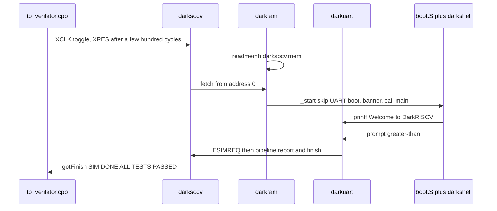

# DarkRISCV tutorial (English summary)

Full walkthrough: **[TUTORIAL_zh.md](TUTORIAL_zh.md)** (Chinese).
Proven logs: **[logs/](logs/)**. Command index: **[LEARNING.md](LEARNING.md)**.

## What DarkRISCV is

A from-scratch **RV32I/E** Verilog CPU (optional IRQ, EBREAK, MAC, threads)
aimed at small FPGA SoCs. The core is always Harvard; DarkBridge can present
Harvard or von Neumann to the rest of the chip. Default teaching config is
**3-stage**, `__HARVARD__`, 8 KiB BRAM (`MLEN=13`), DarkUART at `0x40000000`.
Reset PC is `0x0`.

This repository is `weiwan-gmail/darkriscv` (fork of darklife/darkriscv). Work
here is on **develop**. Upstream already had Icarus (`make`) and a GUI-only
Verilator `spidemo`. This fork adds a headless Verilator path, toolchain
auto-detect, and tutorials. Core pipeline RTL is unchanged.

**Co-sim choice:** compile C firmware (`darkshell`) to `darksocv.mem` and load
it with `$readmemh`. The Verilator C++ file only drives clock/reset. That
matches how DarkSoCV was written; a separate C ISS is not added.

## Repo map

| Path | Role |
|------|------|
| `rtl/darkriscv.v` | CPU (3-stage default) |
| `rtl/darksocv.v` | SoC: PLL, bridge, RAM, IO |
| `rtl/darkram.v` | BRAM; `$readmemh("../src/darksocv.mem")` |
| `rtl/darkuart.v` | UART; in `SIMULATION`, `$write` each TX byte |
| `rtl/config.vh` | feature flags; `VERILATOR` now sets `SIMULATION` |
| `sim/darksimv.v` | Icarus clock/reset (`#delay`) |
| `sim/verilator/` | Verilator 5 C++ clock/reset |
| `src/boot.S` + `src/darkshell/` | C firmware |
| `src/darklibc/` | small libc (`printf` → UART) |

## How firmware boots



1. `$readmemh` fills 8 KiB of BRAM from `src/darksocv.mem`.
2. `boot.S` sees UART status 0 (simulation), skips UART download, prints the
   RLE banner, sets `sp`/`gp`, calls `main`.
3. `darkshell` prints board/build/CSR lines, **intentionally** hits `ebreak`
   and a misaligned load to test `stvec`, enables timer IRQ, prints
   **`Welcome to DarkRISCV!`**, then a prompt ending in `>`.
4. DarkUART sees `>` with `__INTERACTIVE__` off, raises `ESIMREQ`. The core
   prints the pipeline report and `$finish()`es.

## Install tools

```bash
sudo apt-get install -y iverilog verilator gcc-riscv64-unknown-elf build-essential
make toolchain-info
```

Verified here: Icarus 12.0, Verilator 5.020, `riscv64-unknown-elf-gcc` 13.2.0.

`CROSS` / `CCPATH` auto-detect `riscv64-unknown-elf-` on PATH (Ubuntu
package). Override with `make CROSS=... CCPATH=...`. `MLEN` in the linker
script is computed with a portable awk loop (Ubuntu `mawk` has no `**`).

## Build C → Verilator → Icarus

```bash
make test_verilator
# Welcome to DarkRISCV!
# SIM DONE after 67311 clock cycles
# verilator_exit=0
# ALL TESTS PASSED.

make test_icarus
# same UART text, Icarus; simulation ok.
```

Optional VCD: `make -C sim/verilator TRACE=1 sim PLUSARGS=+vcd`

## PASS / FAIL

- **PASS (Verilator):** `Welcome to DarkRISCV!` and `ALL TESTS PASSED.` /
  `verilator_exit=0`.
- **PASS (Icarus):** same UART text and `simulation ok.`
- **Timeout:** `TIMEOUT after N clock cycles` / `verilator_exit=2` (default 2e6).

The `debug: *** exception ... breakpoint / load address align` lines are
**expected** (`stvec` probe in `main.c`). They are not a failure.

Logs from a real run:

- Icarus: [logs/04-iverilog-darkshell.txt](logs/04-iverilog-darkshell.txt)
- Verilator: [logs/05-verilator-darkshell.txt](logs/05-verilator-darkshell.txt)

## Next: SERV

- **SERV:** bit-serial RISC-V; same ISA, ~1 bit per cycle. After this pipelined
  DarkSoCV, that is the contrast case on the ladder.

Stay on this tree until `make test_verilator` is green, then read
`rtl/darkriscv.v` around the 3-stage pipeline and `rtl/darkuart.v` around
`SIMULATION` `$write`.
