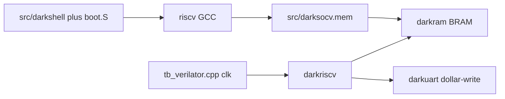
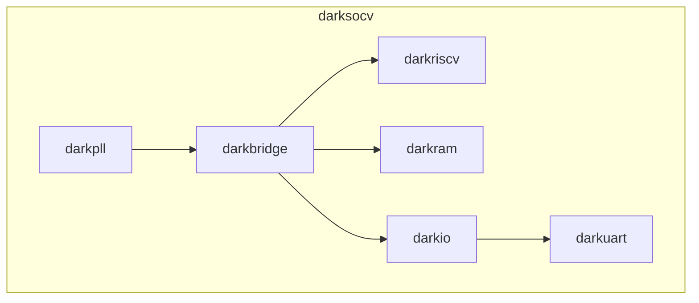
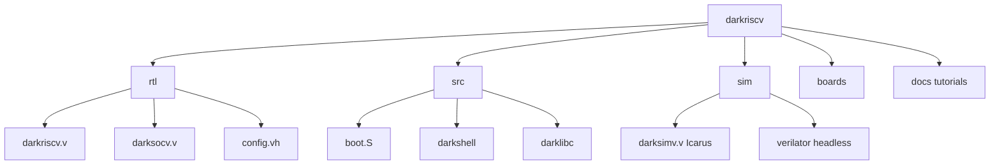
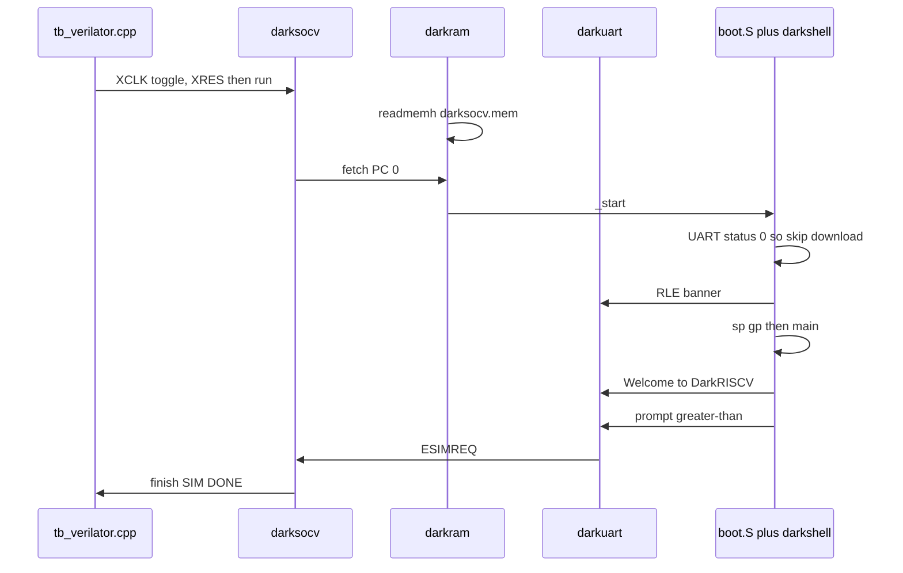

# DarkRISCV 学习教程（中文主文档）

面向 Wei 的完整上手说明：从仓库结构、C 固件如何从地址 0 启动，到用
**C 交叉编译 → mem/hex 灌 BRAM → Icarus / Verilator 同镜像仿真** 跑通
`Welcome to DarkRISCV!`。

英文摘要：[TUTORIAL.md](TUTORIAL.md)
命令速查：[LEARNING.md](LEARNING.md)
本教程里每一条关键命令都在 [logs/](logs/) 里有**真实终端输出**，不是口头推演。

> 工作分支：`weiwan-gmail/darkriscv` 的 **develop**（上游为
> [darklife/darkriscv](https://github.com/darklife/darkriscv)）。
> **不改 CPU 流水线 RTL**（`rtl/darkriscv.v` 保持原样）。只补了工具链探测、
> 便携的 `MLEN` awk、`config.vh` 里 Verilator 自动打开 `SIMULATION`、
> 无头 Verilator 时钟驱动，以及本教程。
>
> 上一档梯子是 FemtoRV / `learn-fpga`（教学多周期 SoC + hex 灌 BRAM）。
> DarkRISCV 是另一种从零写的 RV32：**三级流水、DSP 风格（级间不 stall /
> 不 forwarding）**，外面再套一层真正的 UART/IO SoC（DarkSoCV）。
> 下一档是 **SERV**（位串行）。

---

## 0. 选了哪种 co-sim，为什么

DarkRISCV **本来就**把 C 固件编成 `src/darksocv.mem`（每行一个 32-bit hex
字），`rtl/darkram.v` 用 `$readmemh` 灌进 BRAM，再用 Icarus（`sim/darksimv.v`
里的 `#delay` 时钟）跑。仿真时 DarkUART 对每个 TX 字节 `$write`，看到提示符
`>` 就 `ESIMREQ`，核打印流水线报告后 `$finish`。

Verilator **跑不了** Verilog 里的 `#delay` 时钟，所以上游只在 `spidemo` 上
留了 ImGui 图形 co-sim。教学路径不需要显示器。

所以这里采用 **「C 固件 mem + Verilator C++ 时钟驱动」**：
`sim/verilator/tb_verilator.cpp` 只翻转 `XCLK` / 拉 `XRES`。这不是再写一个
C 指令集模拟器去对拍。CPU 真正执行交叉编译出来的机器码，C++ 侧不是第二套 CPU。

学习用 demo 就是仓库**默认固件 darkshell**（`make test_verilator`）：打印
横幅和 `Welcome to DarkRISCV!`，提示符结束仿真。没有另做一份 hello 目录——
这就是现成的自检。



---

## 1. DarkRISCV 是什么

Marcelo Samsoniuk 从 2018 年一晚上的概念核长出来的 **RV32I/E** 软核，强调
小、快、BSD。默认教学配置：

| 项 | 默认 |
|----|------|
| 流水线 | 3 级（`__3STAGE__`） |
| 总线 | 核永远是 Harvard；SoC 侧 `__HARVARD__` |
| 复位 PC | `0` |
| 存储器 | 8 KiB BRAM（`MLEN=13`） |
| IO | DarkIO：板 ID、LED、定时器、UART @ `0x40000000` |
| ISA | `rv32i_zicsr`（可改 RV32E） |

和前面几档的差别（本档要记住的）：

- **相对 tinyriscv：** 同样三级流水，但总线是 DarkBridge / 自有 RAM-IO 译码，
  不是 RIB；固件是 C `darkshell`，不是 `inst.data` 小测试。
- **相对 picorv32：** 多文件 SoC，不是单文件核；接口不是
  `mem_valid/ready`，而是指令/数据两套 addr+ack。
- **相对 FemtoRV `step20`：** 那边是多周期状态机教学核；这边是流水线 +
  真正的 UART 外设（仿真里短路成 `$write`）。



无板卡宏时：`BOARD_ID=0`（固件打印 `simulation only`），`BOARD_CK=100MHz`。

---

## 2. 仓库地图



| 路径 | 作用 |
|------|------|
| `rtl/darkriscv.v` | CPU |
| `rtl/darksocv.v` | SoC 顶层 |
| `rtl/darkram.v` | 双口 BRAM，`$readmemh("../src/darksocv.mem")` |
| `rtl/darkuart.v` | UART；`SIMULATION` 下 TX 变 `$write` |
| `rtl/config.vh` | 功能开关；`VERILATOR` → `SIMULATION 5` |
| `sim/darksimv.v` | Icarus 时钟/复位（`#delay`） |
| `sim/verilator/` | Verilator 5 C++ 时钟/复位 |
| `sim/cosim.mk` | 可选 GUI `spidemo`（本教程不跑） |
| `src/boot.S` | 复位向量：横幅、设栈、调 `main` |
| `src/darkshell/main.c` | 默认固件 |
| `src/darklibc/` | 小 libc（`printf` → UART） |
| `boards/` | FPGA 工程；本档不碰 |

上游图片仍在 `doc/`（注意没有 s）。本教程在 `docs/`。

---

## 3. 固件怎么从 0 跑起来

链接脚本 `src/darksocv.lds`：整片 `MEM` 从 `0` 开始，长度 `MLEN` 字节
（8 KiB）。`.text` 里 `boot*.o` 放最前，然后空到 **512** 再放其余代码
（给可选 UART 下载留坑）。栈在 `ORIGIN+LENGTH`。



1. `boot.S` `_start`：只让 hart 0 继续。读 `0x40000000` 的 UART status；
   仿真里是 0，**跳过** UART 下载，走 `_normal_boot`。
2. 打印 RLE 大标和 `INSTRUCTION SETS WANT TO BE FREE`。
3. `sp=_stack`，`gp=_global`，`call main`。
4. `main` 打印 `boot0` / `board: simulation only` / `core0: darkriscv@100MHz
   rv32i little-endian`，做 CSR 探测，**故意** `ebreak` 和一次非对齐
   `lw` 来测 `stvec`（所以日志里会有两条 `debug: *** exception`，这是
   **自检**，不是挂了），开定时器中断，再打印 **`Welcome to DarkRISCV!`**。
5. `printf("%d> ", …)` 打出带 `>` 的提示符。`darkuart.v` 在
   `__INTERACTIVE__` 关闭时对此 `$display` 结束语并拉 `ESIMREQ`。
6. `__PERFMETER__` 打印 CPI 报告，`$finish`。

C → 镜像：

```
boot.S + darkshell.a + darklibc.a
  → ld darksocv.o
  → objcopy binary
  → hexdump 每 4 字节一行 hex
  → src/darksocv.mem
```

这就是和 picorv32 / FemtoRV 同一类的 **hex 灌 RAM**，只是文件名叫 `.mem`。

---

## 4. 安装工具

```bash
sudo apt-get install -y iverilog verilator gcc-riscv64-unknown-elf build-essential
make toolchain-info
```

本档实跑版本（见 [logs/01-inspect.txt](logs/01-inspect.txt)）：

- Icarus Verilog 12.0
- Verilator 5.020
- `riscv64-unknown-elf-gcc` 13.2.0（Ubuntu 包，`-march=rv32i_zicsr -mabi=ilp32`）
- awk 是 **mawk**（没有 `2**n`，所以 `src/Makefile` 用循环算 `2^MLEN`）

`src/config.mk` 会按 PATH 探测：

1. `riscv64-unknown-elf-gcc`（Ubuntu）
2. `riscv32-unknown-elf-gcc`
3. `riscv-none-elf-gcc`（xpack）
4. 否则回落到上游的 `/usr/local/share/gcc-riscv32-embedded-elf/bin`

覆盖：`make CROSS=riscv32-unknown-elf CCPATH=/opt/riscv/bin`。

---

## 5. 绿色命令：C → Verilator

```bash
make test_verilator
```

它会：需要的话编 `src/darksocv.mem` → Verilator 编 DarkSoCV → 在 `sim/`
目录运行（保证 `$readmemh("../src/darksocv.mem")` 和 Icarus 同一条路径）→
在日志里确认 `Welcome to DarkRISCV` 和 `ALL TESTS PASSED`。

期望结尾（完整日志：[logs/05-verilator-darkshell.txt](logs/05-verilator-darkshell.txt)）：

```
Welcome to DarkRISCV!

659> the __INTERACTIVE__ option is disabled, ending simulation...
****************************************************************************
DarkRISCV Pipeline Report (67013 clocks, 38637 instr, CPI = 1.73):
core0: 58% run, 6% wait (0% i-bus, 6% d-bus/rd, 0% d-bus/wr), 36% flush
****************************************************************************
SIM DONE after 67311 clock cycles
verilator_exit=0
ALL TESTS PASSED.
```

分步：

```bash
make -C src all
make -C sim/verilator sim
```

可选波形：`make -C sim/verilator TRACE=1 sim PLUSARGS=+vcd`（默认关，仿真才快）。

可选 CMake 双树（Make/Bazel 不动）把同一条 Verilator 路径包一层：
[CMAKE.md](../CMAKE.md)。Windows（withlimon `verilator_bin.exe`）已在 PC2023
跑通：[WINDOWS.md](../cmake-system/WINDOWS.md)。

---

## 6. 同一份镜像：Icarus

```bash
make test_icarus
```

这是 `make -C sim NO_WAVE=1`：和上游 `make` 同一套 TB，只是关掉
`$dumpvars`，避免巨大 VCD。UART 文本应与 Verilator **逐字相同**（本档实跑
CPI 都是 1.73 / 67013 clocks）。完整日志：
[logs/04-iverilog-darkshell.txt](logs/04-iverilog-darkshell.txt)。

上游默认仍然是：

```bash
make          # Icarus + sim/darksocv.vcd
gtkwave sim/darksocv.vcd
```

**不要改这条默认路径。**

Icarus 会多打几行未实例化 SDRAM 模型的 `initial` 提示，以及
`$readmemh`「文件比 2048 字短」的 WARNING（固件约 1988 字，其余已在
`SIMULATION` 里清零）。Verilator 不elaborate 未用模块，所以没有那些行。
不影响 PASS。

---

## 7. 怎么判断 PASS / FAIL

| 现象 | 含义 |
|------|------|
| 大标 + `INSTRUCTION SETS WANT TO BE FREE` | `boot.S` 在跑 |
| `board: simulation only (id=0)` | 无板卡宏，仿真配置 |
| `debug: *** exception ... breakpoint / load address align` | **预期**：`main.c` 测 `stvec` |
| `Welcome to DarkRISCV!` | C `main` 自检走完 |
| `659>` 然后 ending simulation | 提示符触发 `ESIMREQ` |
| Pipeline Report + `$finish` | 核同意结束 |
| `verilator_exit=0` / `ALL TESTS PASSED.` | C++ 看到 `$finish`，不是超时 |
| `TIMEOUT` / `verilator_exit=2` | 2e6 周期内没 `$finish` |
| `invalid XIDATA` | 映像没灌进去或 endian 不对 |

Makefile 还会 `grep` `Welcome to DarkRISCV`，避免「随便 `$finish` 也算过」。

---

## 8. 可选、但不是绿色命令

- **GUI `spidemo`：**  
  `make clean all APPLICATION=spidemo NOBANNER=1 SPIBB=1 COSIM=1`  
  需要 SDL2 / ImGui。上游实验路径，本档不要求。
- **CoreMark / Dhrystone / donut：** 改 `src/Makefile` 的 `APPLICATION`，
  并按 README 加大 `MLEN`。不是入门 PASS。
- **FPGA `boards/`：** 各家工程保持原样。仿真过了再碰板。
- **FuseSoC / Bazel：** 仓库里有，本教程不走。

---

## 9. 建议阅读顺序（过绿之后）

1. `rtl/darkuart.v` 里 `ifdef SIMULATION` 的 `$write` / `>` / `ESIMREQ`。
2. `rtl/darkram.v` 的 `$readmemh` 和 Harvard 指令口。
3. `rtl/darkriscv.v` 三级：IF/ID/EX，以及为什么 load 要 wait、跳转要 flush
   （日志里 36% flush 就是这个）。
4. `src/boot.S` 和 `src/darksocv.lds` 对照 FemtoRV / picorv32 的链接脚本。

---

## 10. 下一档：SERV

梯子到这里：

**tinyriscv → picorv32 → FemtoRV → DarkRISCV → SERV**

SERV 是 **位串行** RISC-V：同样 RV32I，每个周期只推进大约 1 bit，面积极小。
读它之前请先让本仓库的 `make test_verilator` 保持绿色，并搞清楚 DarkRISCV
一条指令在三级流水里怎么走——再去看「一条指令拆成几十拍」会更有感觉。

本 PR **合进 develop 即可，不要 merge 到上游 master**。
